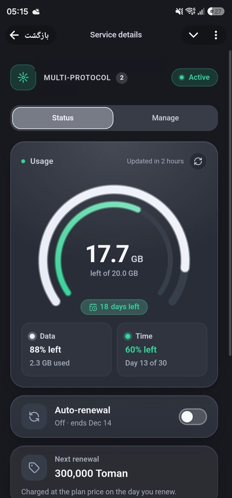
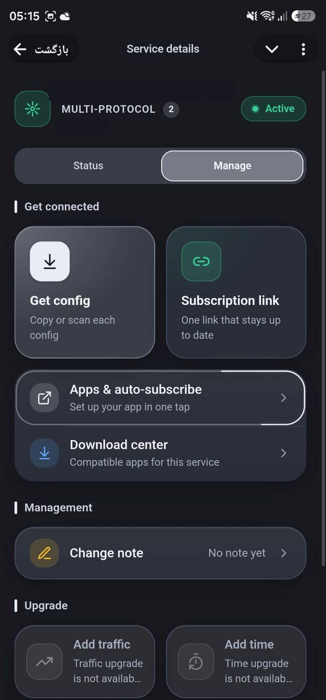

# DLSP: Checking usage and getting connected

**Mohammadhossein Zare**

A mobile UX case study on separating monitoring from setup and management.

---

# What does a returning subscriber need?

- **Monitor:** See remaining data and time without scanning account actions.
- **Manage:** Get setup details or a subscription link when connecting another device.

The split groups related choices together. Each view is easier to focus on, and users do not have to scroll past unrelated controls to find the right action.

---

# Status and Manage have different jobs

| Status: monitor | Manage: act |
|---|---|
|  |  |

These are the two implemented views of the same service, not a before-and-after comparison. Identifiers have been masked.

---

# Why use tabs instead of one long page?

- **One page:** One destination, but monitoring and setup compete for space.
- **Shortcut on Status:** Fast for one task, but duplicates an action area.
- **Dedicated tabs:** One tap to switch goals, with less unrelated content in each view.

Upgrade remains below the core connection actions.

---

# Demo: from Status to a connection option

Open the [DLSP Figma prototype](https://www.figma.com/proto/xlMfwAFsziZRuoTJ4dYbMb?node-id=5-2). Use slide 3 as a backup if it does not load.

**Status → Manage → Get config or Subscription link.**

Show one outcome, return to Manage, and try the other branch. The results are placeholders. If the viewer fails, use the two screenshots above.

---

# What feedback supported the split?

- **Feedback:** Users of the live application informally responded positively to keeping monitoring apart from setup and management.
- **Why keep it:** When users have several protocols or methods to connect, they can find those options together without mixing them with usage and validity.
- **Scope:** The feedback is qualitative. The prototype demonstrates the route; no measured improvement is claimed.

[Seven-minute speaker notes](speaker-notes.md)
