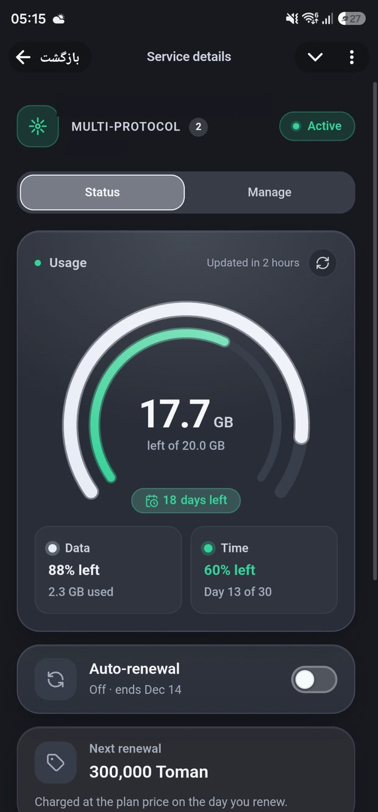
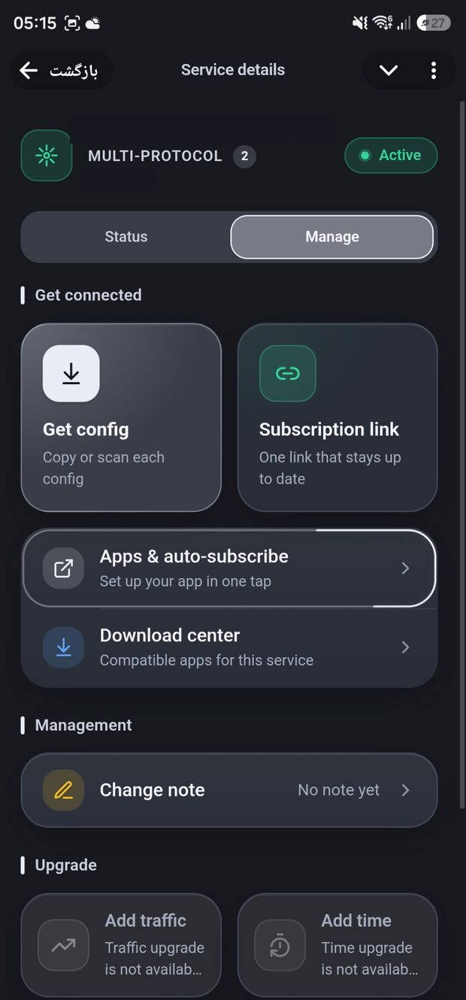

# DLSP case study

## The decision
A returning VPN subscriber may need to check how much data or time is left, or to set up another device. The implemented mobile interface splits those goals. Status keeps usage, validity and renewal information together. Manage puts **Get config** and **Subscription link** first, then app help, notes and upgrades. **Add traffic** and **Add time** stay together under Upgrade.

<table><tr><th>Status: monitor</th><th>Manage: act</th></tr><tr><td></td><td></td></tr></table>

These are two current screens of the same service, not a before/after pair. Service identifiers were masked; the full screenshot frame was retained. The split was implemented before the course. The split keeps monitoring and service actions from getting mixed together. That gives each view a clear purpose, especially when setup may involve different protocols or devices. Less scrolling is one benefit of keeping unrelated controls out of the way. Informal feedback from live users supported keeping the two views separate.

## Timeline

These rows map the available work to course weeks; they do not record dates of participant sessions.

| Week | Goal or milestone | Verifiable result |
| --- | --- | --- |
| 01 | Problem and scope | [Problem brief](../homework/01/README.md) |
| 02 | Research approach and provisional journey | [Research plan](../homework/02/README.md) |
| 03 | Comparable-service usability review | [Comparator evidence](../homework/03/README.md) |
| 04 | Alternatives and prioritization | [Design alternatives](../homework/04/README.md) |
| 05 | Information architecture and task flow | [Sitemap and flow](../homework/05/README.md) |
| 06 | Screen hierarchy, states and responsive layout | [Wireframes](../homework/06/README.md) |
| 07 | Interactive walkthrough | [Prototype and constraints](../homework/07/README.md) |
| 08 | Usability protocol and visual guidance | [Test and UI guidance](../homework/08/README.md) |
| 09 | Design decisions and reusable components | [Decision and component notes](../homework/09/README.md) |
| 10 | Presentation, demo and backup | [Presentation](../homework/10/README.md) |

## GitHub Projects

The instructor-accessible GitHub Projects board has not yet been linked.

## Additional documents
- [Architecture and task flow](docs/architecture.md)
- [Decisions, trade-offs and risks](docs/decisions.md)
- [Wireframes and view rules](docs/wireframes.md)
- [Testing plan and results boundary](docs/validation.md)
- [Project timeline](docs/timeline.md)
