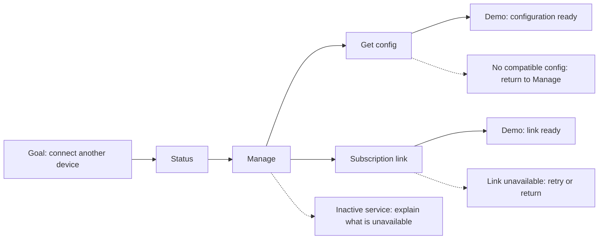

# Information architecture

| Level | Purpose | Contents |
|---|---|---|
| Service details / Status | Monitor the service | Remaining data and time, status, usage, auto-renew and next renewal |
| Service details / Manage / Get connected | Set up a device | Get config, Subscription link, apps and auto-subscribe, download center |
| Service details / Manage / Management | Maintain account details | Change note |
| Service details / Manage / Upgrade | Adjust the plan when available | Add traffic and Add time |

The dotted branches are design cases. The prototype is expected to demonstrate one recoverable exception; do not infer the remaining branches are implemented. The prototype never exposes a real configuration or link. The four core wireframes are Status, Manage, configuration outcome and subscription-link outcome.

