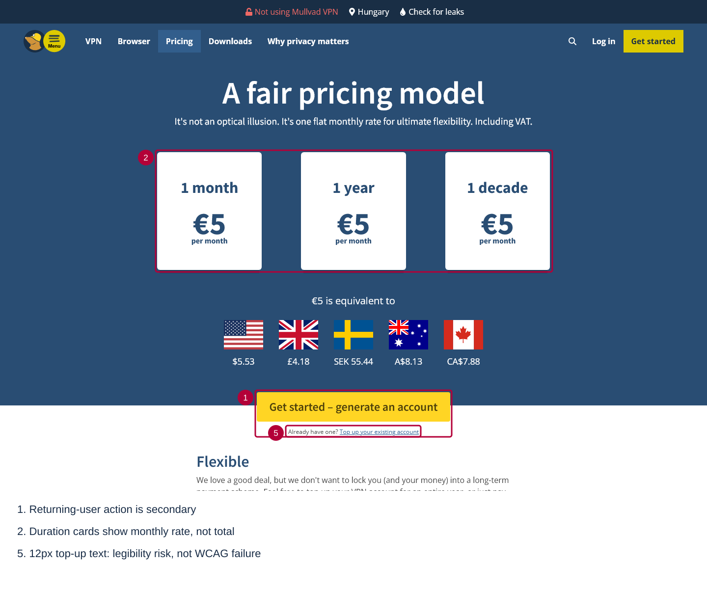
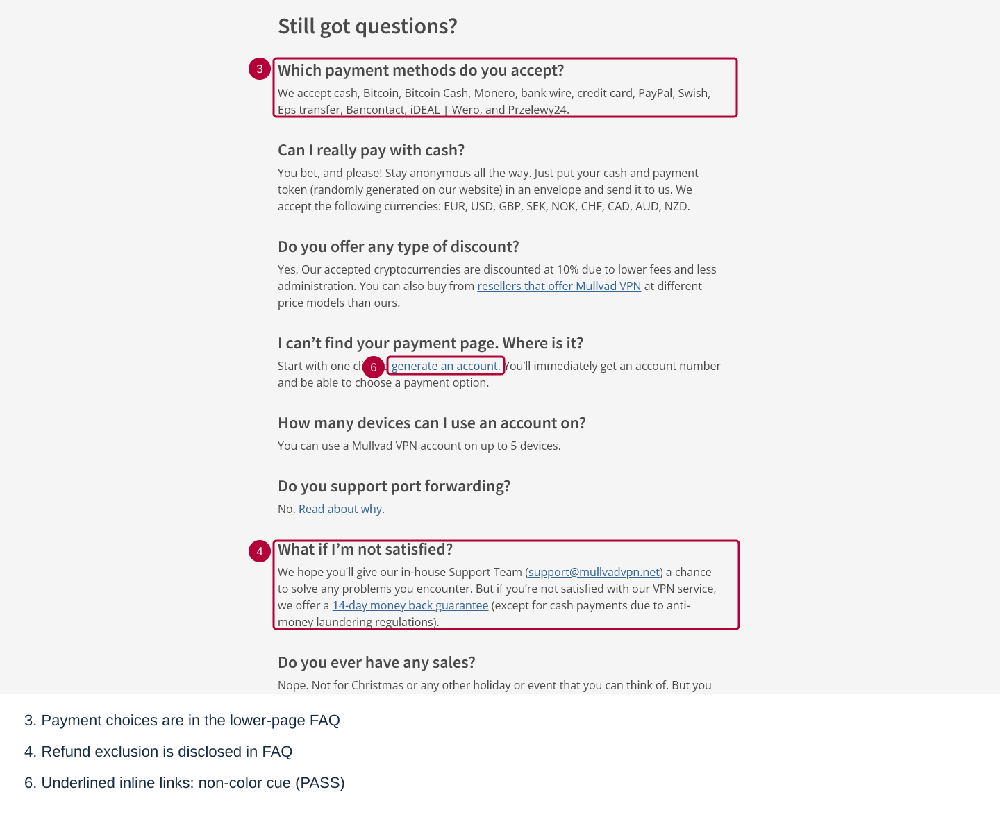

# Comparator: returning-account action discovery

[Source: Mullvad public pricing page](https://mullvad.net/en/pricing). Prior review captured desktop and 320 px mobile views on 13 November 2026. The reviewed task was finding an existing-account route from a public pricing page. No account was created and no checkout or VPN configuration was accessed.

| No. | Observation | User consequence and design response |
|---|---|---|
| 1 | Returning-account link sits below a larger account creation CTA. | Returning users could start the wrong flow. Give DLSP's intended action a clear label and a prominent position. |
| 2 | Example durations emphasize equivalent monthly prices. | Readers must calculate the total for comparison. Pair numerical values with the units relevant to the decision. |
| 3 | Payment options appear in a lower FAQ. | Extra scanning before deciding; put prerequisite information near its action. |
| 4 | Cash refund exclusion is disclosed in the FAQ. | Important context can be missed if users do not scroll. Place task-specific limits alongside the affected action. |
| 5 | Returning link text was 12 CSS px versus 16 px body copy. | A readability risk, not a WCAG failure; use comfortably sized, visible action text. |
| 6 | Underlined FAQ links, visible skip-link focus and no page-wide mobile overflow were observed. | Positive patterns: use non-color cues and verify keyboard focus and narrow-width behavior. |

Manual keyboard check: Tab showed a skip link with visible focus. Enter, then Tab, moved focus into the primary CTA. The 320 px viewport did not horizontally overflow. These checks do not establish accessibility conformance or two actual accessibility failures. Only the normal public state was observed. Loading, empty, error, success and disabled transaction states were not accessible in this scope. No deceptive pattern was established.
