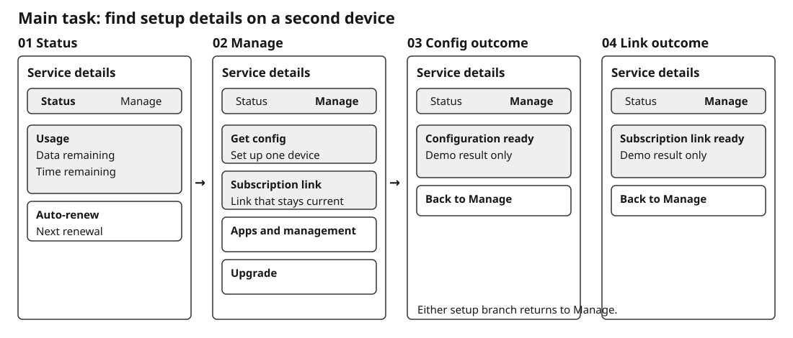
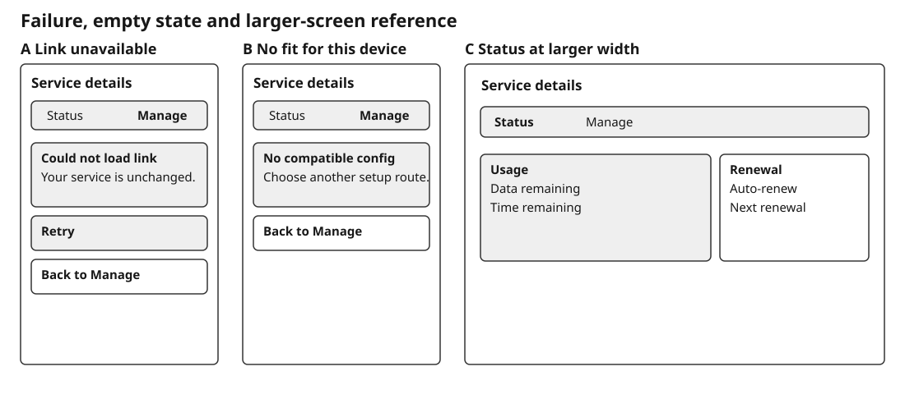

# Wireframe and UI guidance

These diagrams document the structure. The author checked the wireframes and components in Figma. The playable file uses the graphite visual design.

| Frame | Core layout | Primary action |
|---|---|---|
| Status | Service header; Status / Manage; usage and remaining time; renewal detail | Open Manage when setup is needed |
| Manage | Same header and tabs; Get connected group; other management; Upgrade below | Get config or Subscription link |
| Config outcome | Clear ready message, placeholder only, Back | Return to Manage |
| Link outcome | Clear ready message, placeholder only, Back | Return to Manage |
| Failure or empty state | Explain unavailable item; preserve navigation; offer Retry where safe | Retry or return |

At narrow width keep content in one vertical flow. At larger widths constrain the content and place usage and renewal summaries in adjacent columns if the reading order stays clear. Retain the same tab order and explicit labels. Production behavior, copy-to-clipboard and deep-linking are outside this demo.

| UI role | Guidance |
|---|---|
| Background / panel | Graphite, with distinct surfaces |
| Primary text | Off-white, no color-only status |
| Success and time | Green plus an icon or label |
| Usage gauge | Silver/white plus numeric data and unit |
| Actions | Clear verbs, visible focus, disabled reason outside the control |

Use consistent 8 / 16 / 24 spacing. Candidate palette check: off-white `#F3F5F4` on graphite `#151C1A` ≈ 15.8:1; mint `#8DE1BB` on graphite ≈ 11.2:1. These are candidate colors, not a full audit of the live Figma file.
